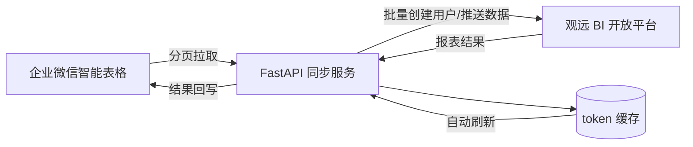

# 用 WorkBuddy 辅助开发 FastAPI，打通企业微信与观远 BI

这是一次集成开发的复盘记录。我们做了一个内部服务：把企业微信智能表格里的数据，同步到观远 BI，再把 BI 侧的报表结果回写到企微。整个过程用 WorkBuddy 辅助完成——从接口调研、代码生成到排错，它参与了大部分环节。

这篇文章不按"教程"写，而是按"我们做成了什么、怎么做的、踩了哪些坑、哪些经验可以复用"来写。代码会给关键片段，但重点讲决策过程和那些文档里没写的细节。

## 一句话成果

> 用约 3 周时间，交付了一个稳定的数据同步服务，对接企业微信智能表格和观远 BI 两个平台，解决了 token 鉴权、过期自动刷新、表格分页三个核心问题，日常同步完全自动运行。

## 背景：为什么要做这个集成

我们团队有两个现成的系统，但彼此不通：

- **企业微信智能表格**：业务同事日常在这里维护数据——客户信息、项目进度、运营指标。它易用、灵活，但不擅长做复杂分析和可视化。
- **观远 BI**：分析平台，擅长做报表、看板、多维分析。但它的用户和数据需要从外部灌入。

现实需求是：业务同事在企微表格里录入数据，希望观远 BI 能自动拿到这些数据出报表；反过来，BI 算出来的结果，希望能在企微里看到。

两个平台都有开放 API，理论上能打通。但真要做，有几个麻烦：

1. **两套鉴权体系**。企业微信用 `access_token`，观远 BI 用 `token`，获取方式、有效期、传递方式都不一样。
2. **token 会过期**。企微的 `access_token` 有效期 7200 秒，过期后所有接口都失败。不能每次调用都去申请新 token（会被频率拦截），必须缓存 + 自动刷新。
3. **企微表格有分页**。智能表格的记录接口一次最多返回 1000 条，数据量大时必须分页拉取，而且要正确处理分页游标。

这三个问题，是这次集成的真正难点。剩下的 CRUD 都是体力活。

## 为什么用 WorkBuddy 辅助

我们不是从零学这两个平台，而是要在有限时间内交付。选择用 WorkBuddy 辅助，主要基于几点：

- **接口调研**：两个平台的文档都很长，WorkBuddy 能快速把关键字段、参数、错误码提炼出来，省去通读文档的时间。
- **样板代码**：FastAPI 的项目结构、Pydantic 模型、依赖注入这些套路代码，它可以批量生成，我们只需要改业务部分。
- **排错**：遇到 token 过期、分页断层这类问题，把错误信息贴给它，它能给出排查方向。

但有一条原则从头到尾没变：**它出初稿，我们做判断和验收**。尤其是鉴权、分页这种容易出隐蔽 bug 的地方，每一段生成的代码我们都逐行看过。

## 成果概览

### 系统架构

整体是一个 FastAPI 服务，对外提供几个 HTTP 接口，内部通过两个客户端分别对接企微和观远：



核心模块：

| 模块 | 职责 |
| --- | --- |
| `wecom_client` | 封装企微接口：获取/刷新 access_token、分页读取表格记录、回写结果 |
| `guandata_client` | 封装观远接口：token 鉴权、批量创建用户、数据推送 |
| `token_manager` | 统一的 token 缓存与过期自动刷新，两个平台共用同一套机制 |
| `sync_service` | 业务逻辑：定时拉取企微表格 → 转换 → 推送观远 |
| FastAPI 路由层 | 对外暴露手动触发、状态查询、健康检查接口 |

### 关键指标

| 指标 | 结果 |
| --- | --- |
| 开发周期 | 约 3 周（含调研和联调） |
| 对接接口 | 企微 3 个 + 观远 2 个 |
| 日常同步 | 定时自动运行，无需人工干预 |
| token 刷新 | 过期前自动刷新，线上未出现过因 token 过期导致的同步失败 |
| 分页处理 | 单次可完整拉取超过 5000 行的表格 |

### 技术栈

- Python 3.11
- FastAPI + Pydantic v2
- httpx（异步 HTTP 客户端）
- APScheduler（定时任务）
- Redis（token 缓存，生产环境）

## 这个项目里，WorkBuddy 到底帮了什么忙

先说结论：它最有用的地方不是"写代码"，而是"压缩调研和排错的时间"。下面按阶段说。

### 阶段一：接口调研

我们把两个平台的文档链接丢给它，让它提炼关键信息。比如企业微信的"开发前必读"文档，它帮我们提炼出几条决定性规则：

- 所有接口用 HTTPS + JSON + UTF-8。
- 调业务接口前先拿 `access_token`，并且**必须缓存**，不能频繁调 `gettoken`（会被频率拦截）。
- 判断接口成功与否，看 `errcode` 是否存在且不为 0；`errmsg` 只是参考，不能作为判据。

这几条如果靠自己通读文档，大概要半小时到一小时；它几分钟就提炼出来了，而且抓住了重点。

观远侧，它从"批量创建用户"接口里提炼出：token 放在请求体里（`body` 的 `token` 字段），而不是放在 header，这是和企微最大的不同。还提炼出 `userDefinedProperties` 里可以绑定企微账号（`wechatwork` 字段）——这一点非常关键，因为我们的需求正是把企微用户映射成观远用户。

### 阶段二：项目骨架

FastAPI 的项目结构、Pydantic 模型定义、依赖注入、配置管理，这些它有很成熟的套路。我们让它一次性生成骨架，然后在这个基础上改业务。

这部分代码质量稳定，几乎没有返工。唯一的问题是它生成的代码默认是同步的 `requests`，而我们想要异步的 `httpx`——明确说一下就改过来了。

### 阶段三：核心逻辑

token 管理、分页处理这些，它给的是"看起来对"的初稿。真正让它可用的是我们的逐行审查和联调。这部分在后面几章详细讲。

### 阶段四：排错

联调时遇到几个诡异问题，把报错贴给它，它能给出方向。比如"token 明明刚拿的，为什么调用还是报过期"，它提示我们检查是不是缓存的 token 和实际使用的 token 不是同一个——这个方向最后证明是对的。

## 接下来几章讲什么

按照"成果展示"的思路，后面重点讲三块硬骨头的解决过程：

1. **token 鉴权**：两个平台怎么统一封装，差异怎么处理。
2. **token 过期**：怎么设计缓存和自动刷新，怎么避免并发惊群。
3. **企微表格分页**：offset/limit/has_more/next 怎么配合，怎么避免漏数据和死循环。

然后讲 FastAPI 服务怎么组织、WorkBuddy 协作的得与失、踩坑清单，以及可复用的经验。

## 第一块硬骨头：token 鉴权

两个平台都要鉴权，但机制完全不同。我们先把差异搞清楚，再决定怎么统一封装。

### 两个平台的鉴权差异

| 维度 | 企业微信 | 观远 BI |
| --- | --- | --- |
| 凭证名称 | `access_token` | `token` |
| 获取方式 | GET `gettoken`，用 `corpid` + `corpsecret` 换 | 用账号密码/密钥换取（按平台规则） |
| 传递位置 | URL 查询参数 `?access_token=xxx` | 放在请求体 `body.token` |
| 有效期 | 7200 秒（2 小时） | 按平台规则，通常更长 |
| 刷新方式 | 过期前重新调 `gettoken` | 按平台规则重新获取 |
| 成功判据 | 返回体 `errcode == 0` | 返回体 `result == "ok"` |

最大的差异有两点：

1. **传递位置不同**：企微把 token 拼在 URL 上，观远把 token 放进 JSON 请求体。这意味着不能简单复用同一个请求函数，至少要做一个适配层。
2. **成功判据不同**：企微看 `errcode`，观远看 `result == "ok"`。如果统一用一种判断逻辑，会误判。

### 企业微信的 token 获取

企微获取 token 的接口是：

```text
GET https://qyapi.weixin.qq.com/cgi-bin/gettoken?corpid=ID&corpsecret=SECRET
```

返回示例：

```json
{
  "errcode": 0,
  "errmsg": "ok",
  "access_token": "accesstoken000001",
  "expires_in": 7200
}
```

要点：

- `corpid` 是企业 ID，`corpsecret` 是应用的密钥，两者都在企微管理后台拿。
- 返回的 `expires_in` 是有效期秒数，通常是 7200，但**不要硬编码**，以返回值为准。
- 判断失败看 `errcode`：非 0 就是失败，`errmsg` 只是参考。

我们的封装（核心片段）：

```python
import httpx
from dataclasses import dataclass
import time

@dataclass
class WecomToken:
    access_token: str
    expires_in: int
    fetched_at: float  # 获取时的时间戳

class WecomClient:
    def __init__(self, corpid: str, corpsecret: str):
        self.corpid = corpid
        self.corpsecret = corpsecret
        self._token: WecomToken | None = None

    async def _fetch_token(self) -> WecomToken:
        async with httpx.AsyncClient() as client:
            resp = await client.get(
                "https://qyapi.weixin.qq.com/cgi-bin/gettoken",
                params={"corpid": self.corpid, "corpsecret": self.corpsecret},
            )
            data = resp.json()
            if data.get("errcode", 0) != 0:
                raise RuntimeError(f"获取企微 token 失败: {data}")
            return WecomToken(
                access_token=data["access_token"],
                expires_in=data.get("expires_in", 7200),
                fetched_at=time.time(),
            )
```

这里有个容易踩的坑：`data.get("errcode", 0) != 0` 这个判断。文档说"errcode 存在且不为 0 判断为失败"，所以缺失 errcode 视为成功。但保险起见，我们也校验 `access_token` 是否存在——如果 errcode 为 0 但没有 token，说明返回异常，也要当失败处理。

### 观远 BI 的 token 获取

观远这边，token 的用法和企微不同。以"批量创建用户"接口为例：

```text
POST /public-api/users/add
Content-Type: application/json

{
  "token": "string",
  "userPropertyType": 0,
  "users": [...]
}
```

返回：

```json
{
  "result": "ok",
  "response": "2 Users created successfully"
}
```

要点：

- token 放在请求体的 `token` 字段，不是 URL 参数，也不是 header。
- 成功判据是 `result == "ok"`，不是 `errcode`。
- `userDefinedProperties` 里可以填 `wechatwork` 字段，用来绑定企微账号——这正是我们需要的。

封装片段：

```python
class GuandataClient:
    def __init__(self, token: str, base_url: str):
        self._token = token
        self.base_url = base_url

    async def _call(self, path: str, payload: dict) -> dict:
        body = {"token": self._token, **payload}
        async with httpx.AsyncClient() as client:
            resp = await client.post(
                f"{self.base_url}{path}",
                json=body,
            )
            data = resp.json()
            if data.get("result") != "ok":
                raise RuntimeError(f"观远接口调用失败: {data}")
            return data
```

这里有一个设计问题：token 被塞进每个请求体。如果 token 过期，每个请求都要更新 token。所以我们把 token 的获取和刷新也收进了统一的 token 管理器（下一章讲）。

### 统一封装：适配层

两个平台的差异，我们用一个"凭证提供者 + 请求适配器"的结构来统一：

```python
from abc import ABC, abstractmethod

class CredentialProvider(ABC):
    @abstractmethod
    async def get_token(self) -> str: ...

class RequestAdapter(ABC):
    @abstractmethod
    def attach_credential(self, token: str, request: dict) -> dict: ...

    @abstractmethod
    def is_success(self, response: dict) -> bool: ...
```

企微适配器和观远适配器各自实现：

```python
class WecomAdapter(RequestAdapter):
    def attach_credential(self, token, request):
        request["params"] = {**request.get("params", {}), "access_token": token}
        return request

    def is_success(self, response):
        return response.get("errcode", 0) == 0

class GuandataAdapter(RequestAdapter):
    def attach_credential(self, token, request):
        request["json"] = {**request.get("json", {}), "token": token}
        return request

    def is_success(self, response):
        return response.get("result") == "ok"
```

这样业务层只调统一的 `call_api`，不用关心底层是 URL 参数还是请求体。

### 为什么值得做这层抽象

一开始我们想偷懒，直接写两个独立的 client，各调各的。但很快发现问题：

- token 过期的处理逻辑要写两遍，而且两边细节不同，容易漏。
- 日志、重试、超时这些横切逻辑也要写两遍。

做成适配层后，token 刷新、重试、日志都集中在统一的地方，两个平台只需要实现自己的差异部分。这部分重构是值得的——后面处理 token 过期时，我们只改了一个地方。

::: tip 踩坑记录
企微的 token 传递有个细节：`access_token` 要放在 URL 查询参数里，不能放在 body。我们一开始把 token 放进了 JSON body，接口一直报 40014（无效的 access_token），排查了半天才发现是传递位置错了。文档里写得清楚，但生成的代码没注意，所以这类地方必须逐行看。
:::

## 第二块硬骨头：token 过期

token 鉴权解决的是"怎么拿到凭证"，token 过期解决的是"凭证失效后怎么办"。后者才是真正会引发线上事故的地方。

### 问题是怎么暴露的

联调阶段一切正常。但服务跑了一个多小时后，突然开始报企微接口错误：

```json
{"errcode": 42001, "errmsg": "access_token expired"}
```

这就是企微的 token 过期错误码。7200 秒（2 小时）有效期一到，之前拿的 token 就失效了。

更麻烦的是：我们的服务是 7×24 运行的，意味着每天都会过期。如果人工处理，不可能每次都盯着。必须自动刷新。

### 第一版方案：每次调用前检查

最直觉的做法：每次调接口前，检查 token 是不是快过期了，是就重新获取。

```python
# 第一版：简单但有问题的实现
class TokenManager:
    def __init__(self):
        self._token = None
        self._expire_at = 0

    async def get_token(self):
        if self._token is None or time.time() >= self._expire_at:
            token = await self._fetch_token()
            self._token = token.access_token
            self._expire_at = token.fetched_at + token.expires_in
        return self._token
```

这个方案能用，但有两个隐患：

1. **边界时刻失败**：如果 token 在"检查通过"和"实际使用"之间恰好过期（虽然窗口很小），请求还是会失败。
2. **并发惊群**：我们用的是异步服务，可能同时有多个请求进来。如果 token 刚过期，多个协程同时发现"需要刷新"，就会同时调 `gettoken`。企微对 `gettoken` 有频率限制，频繁调用会被拦截——这是文档明确警告的。

第二个问题是真正致命的。我们必须解决。

### 第二版方案：提前刷新 + 并发锁

改进点有两个：

**1. 提前刷新**：不等到过期才刷新，而是在过期前 N 秒（比如 300 秒）就刷新。这样即使有一点点时间偏差，也不会在边界失败。

**2. 并发锁**：用 `asyncio.Lock` 保证同一时刻只有一个协程去刷新 token，其他协程等待结果。

```python
import asyncio
import time

class TokenManager:
    # 提前刷新的安全边际：过期前 5 分钟刷新
    REFRESH_MARGIN = 300

    def __init__(self, fetcher):
        self._fetcher = fetcher          # 异步获取 token 的函数
        self._token = None
        self._expire_at = 0.0
        self._lock = asyncio.Lock()

    async def get_token(self, force: bool = False) -> str:
        now = time.time()
        # 快过期或强制刷新时，进入刷新流程
        if force or self._token is None or now >= self._expire_at - self.REFRESH_MARGIN:
            async with self._lock:
                # 双重检查：拿到锁后再检查一次，避免重复刷新
                now = time.time()
                if force or self._token is None or now >= self._expire_at - self.REFRESH_MARGIN:
                    data = await self._fetcher()
                    self._token = data.access_token
                    self._expire_at = data.fetched_at + data.expires_in
        return self._token
```

这里的"双重检查"是关键：

- 外层检查：绝大多数情况下 token 没过期，直接返回，不进锁，性能好。
- 内层检查：拿到锁后再检查一次。因为可能多个协程同时通过外层检查、排队等锁，第一个协程刷新完后，后面协程拿到锁时 token 已经是新的，不需要再刷新。

这样既避免了并发惊群，又不会每次都加锁影响性能。

### 第三版：被动刷新——错误码触发

提前刷新解决了大部分情况，但还有一种情况没覆盖：**token 在服务端被提前撤销**。比如管理员在后台重置了应用密钥，我们本地缓存的 token 立刻失效，但本地还以为没过期。

这种情况下，接口会返回 `42001`（token 过期）或 `40014`（无效的 token）。我们的处理是：在请求层捕获这个错误码，强制刷新 token 后重试一次。

```python
async def call_with_retry(self, request: dict) -> dict:
    # 第一次尝试
    token = await self.token_manager.get_token()
    request = self.adapter.attach_credential(token, request.copy())
    response = await self._do_request(request)

    if self.adapter.is_success(response):
        return response

    # 判断是不是 token 相关错误
    errcode = response.get("errcode")
    if errcode in (40014, 42001):
        # 强制刷新后重试一次
        token = await self.token_manager.get_token(force=True)
        request = self.adapter.attach_credential(token, request.copy())
        response = await self._do_request(request)

    return response
```

这里有个重要的边界：**只重试一次**。如果强制刷新后还是失败，说明问题不在 token（可能是权限、参数错误），继续重试没有意义，还可能触发频率限制。直接把错误抛给上层处理。

### 主动 + 被动，双保险

最终方案是主动刷新和被动刷新结合：

- **主动**：过期前 5 分钟自动刷新，覆盖正常情况。
- **被动**：遇到 40014/42001 错误码时强制刷新重试，覆盖 token 被提前撤销的意外情况。

上线后跑了一个多月，没有再出现过因 token 过期导致的同步失败。

### 观远 token 的过期处理

观远这边，token 的过期规则和企微不同。我们的处理策略是：

- 把 token 也纳入 `TokenManager` 管理，用获取时返回的 `expires_in` 来判断过期。
- 观远的请求体里带 token，所以刷新后要更新请求体（而不是 URL 参数）——这正是适配层 `attach_credential` 的作用。
- 观远的错误判据是 `result == "ok"`，不是 `errcode`。所以被动刷新时看的是它自己的错误字段。

统一 `TokenManager` 管理两个平台的 token，是这个设计里最值钱的部分。它把"什么时候该刷新"这个复杂逻辑收敛到了一个地方。

::: warning 一个真实的教训
我们曾经把企微的 7200 秒硬编码进了代码。后来企微调整了返回的有效期（虽然目前还是 7200，但文档说以返回值为准），我们差点出问题。正确的做法是永远读返回的 `expires_in`，不要相信文档里的固定值——文档会变，接口返回值不会骗你。
:::

### 用 Redis 做生产环境的缓存

本地内存缓存有个问题：服务多实例部署时，每个实例都缓存一份 token，各自刷新，等于刷新了 N 次。生产环境我们用 Redis 做共享缓存：

- token 存在 Redis 里，带 TTL（过期时间自动失效）。
- 刷新时用 Redis 的分布式锁，保证多实例只有一个实例刷新。
- 本地保留一份短时间缓存（比如 60 秒），减少对 Redis 的访问。

这部分是部署阶段的优化，开发期用内存缓存就够了。

## 第三块硬骨头：企微表格分页

企微智能表格的记录接口一次最多返回 1000 条。我们的表格经常超过 5000 行，必须分页拉取。这里有两个坑：漏数据和死循环。

### 接口的分页字段

企微"查询记录"接口（`/cgi-bin/wedoc/smartsheet/get_records`）和分页相关的字段：

**请求参数：**

| 字段 | 类型 | 说明 |
| --- | --- | --- |
| `offset` | uint32 | 偏移量，初始 0 |
| `limit` | uint32 | 每页条数，最大 1000；不填或填 0 时，超过 1000 返回 1000，少于 1000 返回全部 |

**返回字段：**

| 字段 | 类型 | 说明 |
| --- | --- | --- |
| `records` | array | 记录数组 |
| `total` | uint32 | 符合条件的总数 |
| `has_more` | bool | 是否还有更多 |
| `next` | uint32 | 下一页的偏移量 |
| `ver` | uint32 | 版本号 |

关键：**用 `next` 作为下一页的 offset，不要自己累加 `offset += limit`**。这是最容易踩的坑——我们一开始自己累加，结果遇到有筛选或删除记录的情况时，`next` 和 `offset + limit` 不一致，导致漏数据。

### 分页拉取的正确写法

```python
async def fetch_all_records(self, docid: str, sheet_id: str) -> list[dict]:
    all_records = []
    offset = 0
    limit = 1000

    while True:
        payload = {
            "docid": docid,
            "sheet_id": sheet_id,
            "offset": offset,
            "limit": limit,
            "key_type": "CELL_VALUE_KEY_TYPE_FIELD_TITLE",
        }
        token = await self.token_manager.get_token()
        request = self.adapter.attach_credential(token, {"json": payload})
        resp = await self._do_request(request)

        if not self.adapter.is_success(resp):
            raise RuntimeError(f"拉取记录失败: {resp}")

        records = resp.get("records", [])
        all_records.extend(records)

        # 关键：用 next 更新 offset，而不是累加
        if not resp.get("has_more"):
            break
        offset = resp.get("next", offset + limit)

        # 防御：避免 next 不前进导致死循环
        if not records and resp.get("has_more"):
            raise RuntimeError("接口返回 has_more=true 但无记录，疑似死循环")

    return all_records
```

### 两个坑，两种防护

**坑一：漏数据**

原因：自己用 `offset += limit` 累加，但在有筛选、删除记录的表格里，`next` 返回的游标和实际行数不对应。累加会跳过记录。

解决：始终用接口返回的 `next` 作为下一次的 offset。

**坑二：死循环**

原因：某些异常情况下，接口返回 `has_more=true` 但 `next` 不前进（比如 `next` 等于当前 offset），循环永远不结束。

解决：加两道防护——

1. 如果 `has_more=true` 但 `records` 为空，直接抛错。
2. 记录每次的 `next` 值，如果发现和上一次相同，也抛错。

```python
last_next = -1
while True:
    # ... 拉取 ...
    next_offset = resp.get("next", offset + limit)
    if next_offset == offset or next_offset == last_next:
        raise RuntimeError(f"分页游标未前进: {next_offset}")
    last_next = next_offset
    offset = next_offset
```

### 关于 limit 的选择

文档说 limit 最大 1000，不填或填 0 时：超过 1000 返回 1000，少于 1000 返回全部。

我们选择显式填 1000，理由：

- 减少请求次数：5000 行数据，1000/页只要 5 次请求；如果 100/页要 50 次。
- 接口有频率限制，请求次数越少越安全。

但要注意单次返回的数据量：1000 行 × 每行多个字段，响应体可能较大。我们测下来没问题，但如果表格字段特别多，可以适当调小 limit。

### 分页和 token 刷新的配合

分页拉取是个长过程，可能在拉到第 3 页时 token 过期。我们的 `fetch_all_records` 每页都重新调 `token_manager.get_token()`，而 token 管理器会在快过期时自动刷新。这样分页过程天然支持 token 刷新——不需要在分页循环里额外处理 token 问题。

这也是把 token 管理做成独立模块的好处：业务代码不用关心 token 什么时候过期。

## 数据落地：观远用户批量创建与结果回写

拉到企微表格数据后，下一步是推给观远。我们的主要场景是把企微表格里的人员信息同步成观远 BI 的用户。

### 字段映射

企微表格里的人员记录和观远用户字段不是一一对应的，需要一个映射层：

| 企微表格字段 | 观远字段 | 说明 |
| --- | --- | --- |
| 姓名 | `name` | 直接映射 |
| 工号 | `loginId` | 作为登录账号 |
| 邮箱 | `email` | 直接映射 |
| 手机 | `mobile` | 直接映射 |
| 企微 userid | `userDefinedProperties.wechatwork` | 关键：绑定企微账号 |

```python
def map_wecom_row_to_guandata_user(row: dict) -> dict:
    return {
        "name": row.get("姓名", ""),
        "loginId": row.get("工号", ""),
        "email": row.get("邮箱", ""),
        "mobile": row.get("手机", ""),
        "role": "participant",
        "enabled": True,
        "userDefinedProperties": {
            "wechatwork": row.get("企微userid", ""),
        },
    }
```

`userDefinedProperties.wechatwork` 这个字段是重点。观远文档说，可以在这里绑定企微账号。我们把企微的 userid 填进去，这样观远侧就能识别对应的企微用户。

### 批量创建的处理

观远的"批量创建用户"接口一次可以创建多个用户：

```python
async def batch_create_users(self, users: list[dict]) -> dict:
    # 分批，避免单次请求过大
    BATCH_SIZE = 100
    results = []
    for i in range(0, len(users), BATCH_SIZE):
        batch = users[i : i + BATCH_SIZE]
        payload = {
            "userPropertyType": 0,
            "users": batch,
        }
        resp = await self.call("/public-api/users/add", payload)
        results.append(resp)
    return {"batches": len(results)}
```

几个决策：

- **分批**：一批 100 个用户。太大容易超时，太小请求次数多。这个数字是我们根据实际响应时间调出来的。
- **幂等**：接口对已存在的用户会怎么处理，要先确认。我们的做法是在同步前先查重，避免重复创建。
- **部分失败**：批量接口可能部分成功部分失败，返回里会说明"2 Users created successfully"这类信息。要记录每批的结果，不能只看整体成功与否。

### 结果回写企微

同步完成后，我们把结果（成功数、失败数、时间）回写到企微表格的一个"同步状态"子表里，方便业务同事查看。这部分用的是企微智能表格的写入接口，逻辑和读取类似，也是分页-aware 的（写入通常不需要分页，但要注意单次写入的行数限制）。

## FastAPI 服务怎么组织

### 目录结构

```text
app/
├── main.py                  # FastAPI 入口，注册路由
├── config.py                # 配置管理（环境变量）
├── clients/
│   ├── base.py              # 适配层抽象基类
│   ├── wecom.py             # 企业微信客户端
│   ├── guandata.py          # 观远 BI 客户端
│   └── token_manager.py     # 统一 token 管理
├── services/
│   └── sync_service.py      # 同步业务逻辑
├── models/
│   └── schemas.py           # Pydantic 模型
└── api/
    └── routes.py            # HTTP 路由
```

### 对外接口

我们暴露了几个简单的 HTTP 接口：

| 接口 | 方法 | 用途 |
| --- | --- | --- |
| `/sync/trigger` | POST | 手动触发一次同步 |
| `/sync/status` | GET | 查询最近一次同步状态 |
| `/health` | GET | 健康检查 |

定时任务用 APScheduler，每天固定时间触发同步。手动触发接口主要用于联调测试和异常情况补跑。

### 配置管理

所有敏感信息（corpid、secret、token）都从环境变量读，不写死在代码里：

```python
from pydantic_settings import BaseSettings

class Settings(BaseSettings):
    wecom_corpid: str
    wecom_corpsecret: str
    guandata_token: str
    guandata_base_url: str
    token_refresh_margin: int = 300

    class Config:
        env_file = ".env"
```

这样本地开发、测试、生产用不同的 `.env`，互不影响。

### 日志与可观测性

集成类服务最怕"悄悄失败"。我们在关键节点都打了日志：

- 每次 token 刷新：记录时间和平台。
- 每页分页拉取：记录 offset 和条数。
- 每批用户创建：记录成功/失败数。
- 每次同步任务：记录总耗时和结果。

出问题时，靠日志能快速定位是哪个环节。

## WorkBuddy 协作的得与失

这部分是这个案例最想分享的内容——不是技术本身，而是"怎么和 AI 一起做集成开发"。

### 做得好的地方

**1. 调研阶段压缩明显**

两个平台的文档加起来几百页，WorkBuddy 能在几分钟内提炼出关键字段和规则。这让我们把精力放在"怎么设计"而不是"怎么找信息"上。

有效的提示词：

```text
目标：从这份企微开发文档里提炼集成要点
输入：[粘贴文档内容]
输出：
  - 鉴权方式和 token 获取
  - 关键请求参数和返回字段
  - 错误码判断规则
  - 频率限制和注意事项
限制：只提炼文档里明确写的，不要推测；保留原始字段名
```

**2. 样板代码一次到位**

FastAPI 骨架、Pydantic 模型、配置管理这些，它生成的可靠性很高。我们几乎没改就用上了。

**3. 排错给方向**

遇到 token 过期、分页漏数据这些问题，把现象和报错贴给它，它能给出排查方向。虽然不是每次都准，但能节省大量"两眼一抹黑"的时间。

### 做得不好的地方

**1. 生成的代码"看起来对"**

token 检查那段，它给的第一版没有考虑并发惊群。代码能跑，但多实例部署时会出问题。这种隐蔽 bug，AI 不会主动告诉你，必须自己审查。

**2. 容易硬编码**

它生成的代码喜欢把文档里的示例值（比如 7200 秒、1000 条）写死成常量。这些值应该来自接口返回或配置项。我们专门检查了一遍所有硬编码。

**3. 对边界情况考虑不足**

分页的"死循环"问题、批量创建的"部分失败"，这些它都没主动处理。它们不是典型的套路代码，AI 倾向于给出"正常路径"的实现。

### 我们的应对原则

总结下来，和 AI 做集成开发，我们坚持了三条：

1. **生成的代码逐行看**，尤其是鉴权、分页、错误处理这些地方。
2. **明确说出非功能要求**："要异步的 httpx""要考虑并发""不要硬编码有效期"——你不说，它默认不考虑。
3. **联调验证而非信任**：生成的代码必须跑起来、测过边界，才算完成。

## 踩坑清单

把这次踩的坑集中列一下，方便后来人对照：

| 坑 | 现象 | 原因 | 解决 |
| --- | --- | --- | --- |
| token 传递位置错 | 企微报 40014 | token 放进了 body，应该放 URL 参数 | 按平台文档明确传递位置 |
| token 过期 | 跑一小时后报 42001 | 没做缓存和自动刷新 | 提前刷新 + 错误码触发被动刷新 |
| 并发惊群 | 多请求同时刷新 token | 没有加锁 | asyncio.Lock + 双重检查 |
| 硬编码有效期 | 接口调整后失效 | 把 7200 写死 | 读返回的 expires_in |
| 分页漏数据 | 数据对不上 | 自己累加 offset | 用接口返回的 next |
| 分页死循环 | 任务卡住 | next 不前进 | 检查 next 是否变化 |
| 批量部分失败 | 误判整体成功 | 只看外层状态 | 记录每批结果 |
| 成功判据混用 | 误判失败 | 企微看 errcode，观远看 result | 适配层各自实现 |

## 可复用经验

### 1. token 管理做成独立模块

不管对接几个平台，把"获取—缓存—刷新"做成统一的 `TokenManager`，通过适配层处理平台差异。这样新增平台时，只需要加一个适配器。

### 2. 主动刷新 + 被动刷新双保险

- 主动：过期前刷新（我们用了 5 分钟安全边际）。
- 被动：遇到特定错误码强制刷新重试一次。

只靠主动，覆盖不了 token 被提前撤销；只靠被动，每次都要失败一次才恢复。两者结合最稳。

### 3. 分页一律用服务端返回的游标

永远不要自己算 `offset += limit`。服务端返回什么 `next` 就用什么，并加游标不前进的防护。

### 4. 非功能要求要明说

用 AI 生成代码时，主动说明：要异步、要考虑并发、不要硬编码、要有超时和重试、要记录日志。这些它不会自动加。

### 5. 集成服务要可观测

关键节点打日志，出问题时能快速定位。集成类服务的失败往往是"静默"的，日志是唯一的线索。

## 安全与限制

- 所有密钥、token 从环境变量读取，不提交到代码仓库。
- 生产环境的 token 缓存用 Redis 并设置合理 TTL。
- 外发数据前脱敏：企微表格里如果有敏感字段，同步前要过滤。
- 接口调用加超时和重试上限，避免被平台频率限制拦截。
- 这个服务只做数据同步，不做业务判断——判断留给人。


## 深入调研：两个平台文档里到底写了什么

前面提到了调研的结论，这里把过程展开。因为集成开发的很多坑，其实在文档里是有提示的，只是容易被忽略。把读文档的过程记下来，比只记结论更有价值。

### 企业微信这边读了哪些文档

我们重点读了三类文档：

1. **开发前必读**（就是给的参考链接那个页面）：讲通用规则——HTTPS、JSON、UTF-8、errcode 判据、access_token 流程、频率限制、可信 IP。
2. **获取 access_token**：专门讲 token 的接口。
3. **智能表格查询记录**：讲表格数据的读取，包括分页字段。

开发前必读里，有几条我们现在回头看觉得特别重要的规则：

**第一条：errcode 判据。** 文档明确说"根据 errcode 存在且不为 0 判断为失败，否则为成功"，并特别强调 `errmsg` 仅作参考、不可作为判据。这条规则看似简单，但我们在观远那边就差点搞混——观远用的是 `result == "ok"`，不是 errcode。如果统一按 errcode 判断，观远的返回会被误判。

**第二条：access_token 必须缓存。** 文档说"不能频繁调用 gettoken 接口，否则会受到频率拦截"。这条直接决定了我们必须做 token 管理，不能图省事每次都申请。

**第三条：可信 IP。** 文档提到新创建的自建应用必须配置可信 IP，只有配置的 IP 能调用接口。这条在联调阶段坑了我们一把——本地开发时 IP 没配，接口一直报权限错误。后来在管理后台加上服务器 IP 才通。

**第四条：权限范围。** 文档说发送消息的范围必须是应用可见范围内的节点，智能表格接口要求自建应用配置到"可调用应用"列表。这些权限配置不在代码里，但在排查"为什么接口返回权限错误"时，第一反应就该想到它。

### 智能表格查询记录接口的关键字段

这个接口是分页处理的主战场。我们把所有和分页、数据相关的字段列出来：

请求侧：

- `docid`：文档 ID，必填。
- `sheet_id`：子表 ID，必填。
- `view_id`：视图 ID，可选。
- `record_ids`：按记录 ID 查，可选。
- `key_type`：返回单元格的 key 类型，可选。有 `CELL_VALUE_KEY_TYPE_FIELD_TITLE`（用字段标题做 key）和 `CELL_VALUE_KEY_TYPE_FIELD_ID`（用字段 ID 做 key）两种。
- `field_titles` / `field_ids`：返回指定列，可选。
- `sort`：排序，可选，注意文档说"不支持和 filter_spec 一起使用"。
- `offset`：偏移量，初始 0。
- `limit`：分页大小，最大 1000。
- `ver`：版本号。
- `filter_spec`：过滤设置，可选。
- `need_formula_result`：是否返回公式、引用结果，可选。

返回侧：

- `errcode` / `errmsg`：错误码。
- `records`：记录数组。
- `total`：符合筛选条件的总数。
- `has_more`：是否还有更多。
- `next`：下一页的偏移量。
- `ver`：版本号。

我们做的一个决策：`key_type` 选 `CELL_VALUE_KEY_TYPE_FIELD_TITLE`，也就是用字段标题做 key。这样业务同事能直接看懂数据，不用维护一套字段 ID 到标题的映射。代价是如果有人改了表格列名，代码要跟着改——这个风险我们接受，因为列名改动不频繁。

### 观远这边读了哪些文档

观远的文档我们主要读了"批量创建用户"这个接口，因为这是我们的核心场景。提炼出的要点：

- 接口路径 `/public-api/users/add`，POST。
- token 放在请求体的 `token` 字段。
- `userPropertyType`：用户属性类型，我们填 0。
- `users` 数组：每个用户包含 `name`、`loginId`、`password`、`role`、`email`、`mobile`、`enabled`、`userGroupIds`、`userDefinedProperties`。
- `userDefinedProperties` 里可以填 `wechatwork`、`dingtalk`、`feishu`、`yunzhijia`、`weaver` 等第三方账号绑定。
- 成功返回 `{"result": "ok", "response": "2 Users created successfully"}`。

`userDefinedProperties.wechatwork` 这个字段是我们的关键发现。它让观远用户能和企微账号绑定，这样业务同事在企微里的身份和观远里的身份能对上。如果文档里没有这个字段，我们可能就做不出完整方案。这也说明了认真读文档的价值——关键功能往往藏在一个不起眼的字段里。

### 调研阶段的工作方法

我们用一个固定的提示词模板让 WorkBuddy 帮忙读文档，效果不错：

```text
目标：从这份 API 文档里提炼集成要点
输入：[粘贴文档正文]
输出：
  - 接口用途和完整 URL
  - 请求方法、参数（字段名/类型/是否必填/说明）
  - 返回字段结构
  - 鉴权方式和 token 传递位置
  - 错误码和成功判据
  - 频率限制、权限、特殊注意事项
限制：
  - 只提炼文档明确写的内容，不要推测
  - 保留原始字段名，不要翻译
  - 分页相关字段单独列出
```

这个模板的关键是"分页字段单独列出"和"保留原始字段名"。前者让我们不会漏掉 offset/limit 这类字段；后者避免 AI 把 `has_more` 翻译成"是否有更多"后，我们对不上代码里的字段名。

## 技术方案的取舍过程

调研完，我们面临几个方案选择。把这些取舍记下来，是因为它们决定了后面的实现难度。

### 选 FastAPI 而不是 Flask

我们团队更熟 Flask，但最后选了 FastAPI，理由：

- 原生异步支持，适合这种大量 HTTP 调用的场景（分页拉取、批量推送）。
- Pydantic 模型能自动校验配置和数据，减少手写校验代码。
- 类型注解完善，AI 生成的代码质量更高——这点很实际，因为我们要用 AI 辅助开发。

Flask 也能做，但要自己处理异步、校验这些，代码量更大。FastAPI 的学习成本我们用一周补上了，后面省下的时间是值得的。

### 选 httpx 而不是 requests

requests 是同步的，在异步的 FastAPI 里用会阻塞事件循环。httpx 支持异步，和 FastAPI 配合更好。这个决定让我们在分页拉取时可以用异步并发，但也带来了"并发惊群"的问题（后面 token 章节讲）——不过那是可解决的，同步阻塞才是真麻烦。

### 同步模式：定时 + 手动

我们没有做实时同步（比如 Webhook 触发），而是"定时 + 手动"：

- 定时：每天固定时间全量同步一次。
- 手动：提供接口，异常时补跑。

理由：业务同事对实时性要求不高，一天一次够用；全量同步逻辑简单可靠，增量同步要处理删除、变更等复杂情况。先做简单可靠的版本，比做复杂但容易出 bug 的版本强。

### 缓存：本地 → Redis

开发期用本地内存缓存 token，生产用 Redis。这是个渐进决策，不是一开始就上 Redis。先把逻辑跑通，再解决多实例问题。如果一开始就纠结 Redis 的分布式锁，会拖慢开发进度。

## 测试：怎么验证那些边界情况

集成开发最怕"看起来能用，实际有坑"。我们专门针对三个核心问题设计了测试。

### 测试 token 过期

token 过期要等 2 小时才能复现，显然不能靠真等。我们的办法是"可控的时钟"：

- 把 token 的 `fetched_at` 和 `expires_in` 做成可注入的参数。
- 测试时把 `expires_in` 设成很小的值（比如 1 秒），或者用一个假的时钟函数控制"当前时间"。
- 这样能在几秒内测出过期行为。

```python
import pytest

@pytest.mark.asyncio
async def test_token_refresh_before_expiry(fake_clock, fake_fetcher):
    manager = TokenManager(fake_fetcher, clock=fake_clock, margin=300)
    token1 = await manager.get_token()

    # 把时钟推进到快过期
    fake_clock.advance(7200 - 300 - 1)
    token2 = await manager.get_token()

    assert token2 != token1  # 应该已经刷新
    assert fake_fetcher.call_count == 2
```

并发惊群的测试：同时发起 10 个 `get_token()` 调用，断言 `fetcher` 只被调用了一次。这个测试直接验证了锁和双重检查是否有效。

### 测试分页

分页测试的重点是"不漏数据、不死循环"：

- 用一个假的分页接口，返回 5 页数据，每页设置不同的 `next`。
- 故意让 `next` 不等于 `offset + limit`（模拟有删除记录的情况），验证代码用的是 `next` 而不是累加。
- 故意让 `has_more=true` 但 `records` 为空，验证代码会抛错而不是死循环。

```python
@pytest.mark.asyncio
async def test_pagination_uses_next_not_offset(fake_paged_api):
    # 假接口：next 故意不等于 offset+limit
    fake_paged_api.set_pages([
        {"records": [1,2], "has_more": True, "next": 17},
        {"records": [3,4], "has_more": True, "next": 33},
        {"records": [5], "has_more": False, "next": 40},
    ])
    result = await fetch_all_records(fake_paged_api)
    assert result == [1,2,3,4,5]
    # 验证第二次请求的 offset 是 17，而不是 2
    assert fake_paged_api.calls[1]["offset"] == 17
```

这个测试是我们后来补上的——因为第一版代码用了累加 offset，这个测试直接把它抓了出来。

### 测试成功判据

针对企微和观远不同的成功判据，各写一个测试：

- 企微：`errcode=0` 判成功，`errcode=42001` 判失败。
- 观远：`result="ok"` 判成功，其他判失败。

这组测试防止我们在重构适配层时把判据搞混。

### 联调测试

单元测试之外，我们用真实环境做了联调：

- 在企微建了一个测试表格，填了 10 条记录（特意少于 1000，先验证基本流程）。
- 又造了一个 5000 行的表格，验证分页完整拉取。
- 观远侧建了测试用户组，验证批量创建。

联调阶段发现了两个单元测试没覆盖的问题：一是可信 IP 没配导致权限错误；二是批量创建时 `userDefinedProperties` 的字段名写错了（观远要求准确的属性名）。这再次说明，单元测试和真实联调都不能省。

## 部署与运维：上线之后的事

案例如果只写到"代码跑通"，是不完整的。上线之后遇到的一些问题，同样值得记录。

### 部署形态

我们最终部署成两个实例（为了可用性），前面挂负载均衡。token 缓存用 Redis，两个实例共享。定时任务只在一个实例上跑（用 Redis 锁选主），避免重复同步。

```text
        ┌─────────┐
        │   LB    │
        └────┬────┘
       ┌─────┴─────┐
       │           │
   ┌───▼───┐   ┌───▼───┐
   │ App 1 │   │ App 2 │
   └───┬───┘   └───┬───┘
       │           │
       └─────┬─────┘
             │
        ┌────▼────┐
        │  Redis  │
        └─────────┘
```

### 多实例下的 token 刷新

单实例的 token 刷新用 `asyncio.Lock` 就够了。多实例时，每个实例都有自己的进程内锁，挡不住其他实例。所以我们加了 Redis 分布式锁：

```python
import redis.asyncio as redis

class RedisTokenStore:
    def __init__(self, redis_client, key: str, ttl: int):
        self.redis = redis_client
        self.key = key
        self.ttl = ttl

    async def get(self) -> str | None:
        return await self.redis.get(self.key)

    async def set(self, token: str):
        await self.redis.setex(self.key, self.ttl, token)

    async def acquire_lock(self, name: str, timeout: int = 10) -> bool:
        # SET NX EX：只有键不存在时才设置，且带过期时间
        return await self.redis.set(
            f"lock:{name}", "1", nx=True, ex=timeout
        )

    async def release_lock(self, name: str):
        await self.redis.delete(f"lock:{name}")
```

流程：要刷新 token 的实例先抢 Redis 锁，抢到的去申请新 token 并写入 Redis，没抢到的等一小会儿再读 Redis。这样多个实例也只有一个在刷新。

### 定时任务选主

同理，定时任务如果两个实例都跑，会同步两次。我们用 Redis 锁做选主：任务触发时先抢一个带 TTL 的锁，抢到的实例执行同步，另一个跳过。TTL 设得比任务执行时间长一点，防止任务没跑完锁就过期。

### 监控与告警

集成服务的失败往往是静默的——不同步了没人知道。我们做了几个简单的监控：

- `/health` 接口：返回服务状态、token 缓存状态、最近一次同步时间。
- 同步失败时打 ERROR 日志，并推送到团队的告警群。
- 定时任务如果超过预期时间没执行，告警。

::: tip 一个经验
集成类服务的监控，重点不是"服务活着吗"，而是"数据在流动吗"。服务进程活着但同步任务卡死，是最危险的情况——表面上一切正常，实际上数据已经几天没更新了。所以我们专门监控"最近一次成功同步的时间"。
:::

### 遇到的问题

**问题一：Redis 连接不稳定。** 有段时间 Redis 偶尔超时，导致 token 读取失败。我们加了本地兜底缓存：Redis 读失败时用本地缓存的 token（即使可能稍旧），并异步重试 Redis。这样 Redis 抖动不会立刻导致同步失败。

**问题二：定时任务时间漂移。** 用 APScheduler 的简单间隔触发，服务重启后会重置计时。后来改成 cron 触发器（固定时间点），行为更可预测。

**问题三：日志太多。** 分页拉取时每页都打日志，5000 行的表格打 5 条还行，但如果字段多、请求频繁，日志量不小。我们把分页日志改成 DEBUG 级别，只在出问题时的排查中打开。

## 数据一致性与幂等

同步服务绕不开一致性和幂等的问题。这部分我们没做到完美，但做了一些务实的处理。

### 幂等：重复同步不能重复创建

定时任务可能因为重试被触发两次，手动也可能误触。如果每次都往观远创建用户，会产生重复用户。

我们的处理：

- 用企微表格的"工号"作为观远的 `loginId`（登录账号）。观远对 `loginId` 应该是唯一的，重复创建同 `loginId` 的用户会失败或被忽略——但这一点要在测试环境验证清楚。
- 同步前先拉取观远现有用户列表（如果有这个接口），做差集，只创建不存在的。
- 如果观远没有方便的查询接口，就在本地维护一个"已同步"的记录表，以 `loginId` 为键。

我们最终用了本地记录表的方式，因为它不依赖观远是否有查询接口，实现更可控。

### 一致性：部分成功的处理

批量创建 100 个用户，可能有几个失败（比如手机号格式不对）。这时候状态是"部分成功"。

我们的策略：

- 记录每一批的结果，失败的条目单独记录原因。
- 不因为个别失败就中断整批——其他成功的用户还是有效的。
- 把失败条目回写到企微表格，让业务同事修正数据后下次同步重试。

这里有个权衡：如果严格追求一致性，应该"全部成功才提交"，但那样一个坏数据会卡住整批。我们选择了"尽量成功 + 记录失败 + 下次重试"，更适合内部工具的场景。

### 全量同步 vs 增量同步

我们用的是全量同步：每次把企微表格的所有记录拉下来，重新同步。优点是实现简单、不漏数据；缺点是数据量大时慢。

如果以后数据量大到全量同步太慢，可以改增量同步——只同步上次之后变更的记录。但这需要处理：

- 删除的记录怎么同步到观远（观远侧要不要删除对应用户）。
- 企微表格有没有可靠的"最后修改时间"字段可用。
- 增量游标怎么维护。

这些都不简单。我们评估后决定：当前数据量下全量同步完全够用，先不引入增量同步的复杂度。这是个务实的取舍。

## 性能和容量

### 分页拉取的性能

5000 行表格，1000/页，5 次请求。每次请求几百毫秒，总共几秒。这个速度对"每天一次"的同步完全够。

我们测试过单个请求的时间，企微接口响应通常在 200-500ms。批量创建观远用户时，100 个一批大概 1-2 秒。

### 频率限制的考虑

两个平台都有频率限制。我们的用量远低于限制（每天几十次请求），所以没有专门做限流。但如果业务扩大、同步频率提高，需要在客户端加限流——比如用令牌桶控制每秒请求数。

### 数据量的上限

当前设计理论上能处理任意大的表格（靠分页），但实际受两个限制：

- 本地内存：全量拉取后数据放在内存里，表格特别大时内存占用高。我们目前的量级（几千行）没问题。
- 接口超时：单次分页请求如果数据太大可能超时。limit 控制在 1000 是安全的。

如果以后表格到几十万行，需要改成分批处理（拉一批处理一批，不全量放内存），而不是全部拉完再处理。

## 团队协作中的 WorkBuddy 使用

这次开发是多人协作，WorkBuddy 的使用也有一些团队层面的经验。

### 统一提示词模板

我们把调研、生成代码、排错三个场景的提示词模板整理成团队共享的文档，每个人用同一套模板。好处是：

- 产出格式一致，便于 review。
- 新人能快速上手，不用自己摸索怎么问。
- 模板持续迭代，把有效的限制条件沉淀下来。

### 代码 review 的特别注意点

因为代码有 AI 参与的痕迹，我们在 review 时特别关注几类问题：

- **硬编码**：示例值有没有被写死（7200、1000 这些）。
- **非功能需求**：异步、并发、超时、重试、日志有没有考虑。
- **边界情况**：空数据、部分失败、游标不前进这些有没有处理。
- **错误信息**：异常信息够不够定位问题。

这几类问题是 AI 生成代码的高频盲区，重点看这些，review 效率最高。

### 知识沉淀

项目结束后，我们把这次的经验整理成两样东西：

1. **踩坑清单**（就是前面那张表），放进团队知识库。
2. **可复用的代码骨架**：token 管理器、适配层基类、分页拉取函数，做成内部模板，下次集成新平台时直接复用。

这样下次再做类似集成，就不用从零开始——这也是我们觉得这次项目最有价值的产出：不只是交付了一个服务，还沉淀了一套可复用的模式。


## 核心代码的完整设计

前面给了不少代码片段，这里把几个核心模块的完整设计讲清楚。这不是为了展示代码量，而是因为这些模块的设计决策，是整个案例的技术核心。

### Pydantic 模型：让数据契约显式化

我们用 Pydantic 定义了企微表格行和观远用户的模型，好处是数据类型和必填项一目了然，且自动校验。

```python
from pydantic import BaseModel, Field
from typing import Optional

class WecomRow(BaseModel):
    """企微智能表格中的一行记录"""
    姓名: str
    工号: str
    邮箱: Optional[str] = None
    手机: Optional[str] = None
    企微userid: Optional[str] = None

class GuandataUser(BaseModel):
    """观远 BI 的用户对象"""
    name: str
    loginId: str
    email: Optional[str] = None
    mobile: Optional[str] = None
    role: str = "participant"
    enabled: bool = True
    userDefinedProperties: dict = Field(default_factory=dict)

def to_guandata_user(row: WecomRow) -> GuandataUser:
    props = {}
    if row.企微userid:
        props["wechatwork"] = row.企微userid
    return GuandataUser(
        name=row.姓名,
        loginId=row.工号,
        email=row.邮箱,
        mobile=row.手机,
        userDefinedProperties=props,
    )
```

这里有个细节：企微表格返回的记录，key 是字段标题（因为我们用了 `CELL_VALUE_KEY_TYPE_FIELD_TITLE`）。所以模型里的字段名直接用中文标题（"姓名""工号"），和表格列一一对应。这让映射很直观，但代价是表格列名改了要同步改模型。我们接受这个代价，因为可读性更重要。

`Optional[str] = None` 处理空值——企微表格里很多字段可能没填，不能假设都有值。Pydantic 会自动把缺失字段填成 None。

### 统一请求层：收敛横切逻辑

我们把所有 HTTP 请求收敛到一个统一的函数，处理超时、重试、日志：

```python
import httpx
import asyncio
from tenacity import retry, stop_after_attempt, wait_exponential

class BaseClient:
    def __init__(self, adapter: RequestAdapter, token_manager: TokenManager):
        self.adapter = adapter
        self.token_manager = token_manager

    @retry(stop=stop_after_attempt(3), wait=wait_exponential(multiplier=1, min=1, max=10))
    async def _do_request(self, method: str, url: str, request: dict) -> dict:
        timeout = httpx.Timeout(30.0, connect=10.0)
        async with httpx.AsyncClient(timeout=timeout) as client:
            if method == "GET":
                resp = await client.get(url, params=request.get("params"))
            else:
                resp = await client.post(url, json=request.get("json"))
            resp.raise_for_status()
            return resp.json()

    async def call(self, method: str, url: str, payload: dict) -> dict:
        token = await self.token_manager.get_token()
        request = self.adapter.attach_credential(token, {"params": {}, "json": payload})
        response = await self._do_request(method, url, request)
        # token 失效时强制刷新重试一次
        if not self.adapter.is_success(response):
            errcode = response.get("errcode")
            if errcode in (40014, 42001):
                token = await self.token_manager.get_token(force=True)
                request = self.adapter.attach_credential(token, {"params": {}, "json": payload})
                response = await self._do_request(method, url, request)
        return response
```

几个设计点：

- **重试**：用 `tenacity` 做指数退避重试，最多 3 次。网络抖动、偶发 5xx 能自动恢复。注意重试只针对网络层面的失败（`raise_for_status`），业务错误（errcode 非 0）不在这里重试，而是在 `call` 里针对性处理。
- **超时**：连接 10 秒，读取 30 秒。不设超时的话，一次卡住会拖死整个同步任务。
- **token 失效重试**：只重试一次，避免触发频率限制。

### 错误处理：区分可恢复和不可恢复

我们把错误分成两类：

- **可恢复**：网络抖动、token 过期、频率限制。这类错误重试或刷新后能恢复。
- **不可恢复**：参数错误、权限不足、数据格式错误。这类错误重试没用，要记录并告警。

```python
class SyncError(Exception):
    """同步过程中的错误，带上下文信息"""
    def __init__(self, stage: str, message: str, data: dict | None = None):
        self.stage = stage      # 哪个阶段出错
        self.message = message
        self.data = data
        super().__init__(f"[{stage}] {message}")
```

在业务层捕获并分类：

```python
try:
    records = await wecom.fetch_all_records(docid, sheet_id)
except SyncError as e:
    logger.error(f"拉取企微记录失败: {e}")
    await notify_failure(e.stage, e.message)
    raise
```

带上 `stage` 信息，出问题时一眼知道是哪个环节——是拉数据、转数据还是推数据。

### 日志规范

我们定了几条日志规则：

- 每个同步任务有唯一的 `task_id`，贯穿所有日志，方便追踪一次同步的全过程。
- 关键节点打 INFO：任务开始/结束、每批推送结果。
- 异常打 ERROR，带堆栈。
- 分页细节打 DEBUG，平时关闭。

```python
import logging
import uuid

logger = logging.getLogger(__name__)

async def run_sync(self):
    task_id = uuid.uuid4().hex[:8]
    logger.info(f"[{task_id}] 同步任务开始")
    start = time.time()
    try:
        records = await self.wecom.fetch_all_records(docid, sheet_id)
        logger.info(f"[{task_id}] 拉取记录 {len(records)} 条")
        users = [to_guandata_user(WecomRow(**r)) for r in records]
        result = await self.guandata.batch_create_users(users)
        logger.info(f"[{task_id}] 推送完成: {result}")
    except Exception as e:
        logger.exception(f"[{task_id}] 同步失败: {e}")
        raise
    finally:
        logger.info(f"[{task_id}] 同步结束，耗时 {time.time()-start:.1f}s")
```

## 安全方面的处理

企业数据集成，安全是绕不开的。我们做了几件事：

### 凭证管理

- 所有密钥（corpid、corpsecret、token）从环境变量读，不进代码仓库。
- `.env` 文件加入 `.gitignore`。
- 生产环境的凭证由运维通过密钥管理系统注入，开发用单独的测试凭证。
- 日志里不打印凭证——这是容易犯的错。我们专门检查了所有日志语句，确保没有把 token 打出来。

### 数据脱敏

企微表格里可能有人名、手机号、邮箱这些个人信息。我们的处理：

- 同步到观远时，只传必要的字段。
- 测试环境用假数据，不拿真实人员信息测试。
- 日志里不打印完整的用户数据，只打印条数和 ID。

### 权限最小化

- 企微应用只申请需要的权限（文档权限），不申请通讯录全量权限。
- 观远用户用最小权限的角色（`participant`），不用管理员角色。
- 服务的网络访问限制在必要的域名（企微 API、观远 API）。

### 可信 IP

前面提到企微要求配置可信 IP。我们把服务的出口 IP 加到企微管理后台的可信 IP 列表。这里要注意：如果用负载均衡，出口 IP 可能是 LB 的 IP，不是单个实例的 IP——要确保配置的是正确的出口 IP。我们在这上面踩过坑，配置了实例 IP 但没配 LB IP，导致生产环境调用失败。

## 如果重来一次，我们会怎么做

复盘的最后，想想哪些地方可以做得更好。

### 更早做真实环境的联调

我们在开发后期才连真实环境，导致一些配置类问题（可信 IP、权限、字段名）发现得晚。如果重来，第一天就把测试环境的凭证拿到，先跑通一个最小请求，再展开开发。这样配置问题会尽早暴露。

### 一开始就用可控时钟测 token

token 过期的测试我们是后补的，因为一开始图省事没做可控时钟。如果重来，从写第一行 token 管理代码起就用可注入的时钟，过期测试会容易得多，也能更早发现并发问题。

### 更早收敛到适配层

我们一开始写了两个独立的 client，后来才重构成适配层。重构花了时间。如果重来，从一开始就用适配层抽象——反正两个平台的差异是已知的，先设计好抽象再写实现，反而更快。

### 减少 AI 生成代码的盲区

我们看到 AI 生成代码的几个高频盲区：硬编码、不考虑并发、不处理边界。如果重来，我们会在提示词模板里把这些要求写死（"不要硬编码有效期""考虑并发刷新""处理空数据和部分失败"），并要求生成后自查。这样能减少 review 时的返工。

### 文档沉淀前置

踩坑清单和可复用模板是项目结束后才整理的。如果重来，我们会在开发过程中随手记录——遇到一个坑就记一条，及时且准确。事后回忆容易遗漏细节。

## 写在最后

这次集成开发，技术上没有特别高深的东西，难点都在工程细节：token 的缓存与刷新、分页的正确处理、错误码的准确判断、并发和边界情况。这些细节文档里都有提示，但要真正做对，需要仔细设计加上充分测试。

WorkBuddy 在整个过程中是个高效的助手——调研、样板代码、排错方向，它都帮了忙。但它生成的"能跑的代码"离"可靠的代码"还有距离，这个距离要靠人的审查、测试和联调来填。这是我们用下来最真切的体会。

如果你也在做类似的平台集成，希望这篇复盘里关于 token 和分页的经验，能帮你少熬几个夜。


## 错误码与返回值速查

集成开发时，错误码是最常查的东西。我们把这次遇到的错误码和判据整理成速查表。

### 企业微信常见错误码

| errcode | 含义 | 我们的处理 |
| --- | --- | --- |
| 0 | 成功 | 正常处理 |
| 40014 | 无效的 access_token | 强制刷新 token 后重试一次 |
| 42001 | access_token 过期 | 强制刷新 token 后重试一次 |
| 40001 | 无效的凭证（corpid/secret 错） | 不可恢复，告警人工处理 |
| 41001 | 缺少 access_token | 检查 token 传递位置 |
| 45009 | 接口调用超过频率限制 | 退避重试，检查是否频繁刷新 token |
| 60020 | 不可信 IP | 检查管理后台的可信 IP 配置 |
| 301002 | 无权限访问文档 | 检查应用是否加入可调用应用列表 |

关于错误码判断，有一条我们反复强调：`errmsg` 不能作为判据。文档明确说 `errmsg` 后续可能变动。我们吃过一次亏——测试时用 `errmsg` 包含"ok"来判断成功，结果某次接口返回的提示文案变了，判断就失效了。后来全部改成看 `errcode`。

### 观返回的判据

观远的"批量创建用户"接口返回：

```json
{
  "result": "ok",
  "response": "2 Users created successfully"
}
```

成功判据是 `result == "ok"`。失败时 `result` 不是 ok，`response` 里是错误说明。注意 `response` 是给人看的字符串，不适合程序判断——我们只用它记日志。

### 通用原则

不管哪个平台，判断成功要满足：

1. HTTP 状态码是 2xx（网络层成功）。
2. 业务返回的成功标志正确（企微 errcode=0，观远 result=ok）。
3. 关键数据字段存在（比如 token 接口返回了 access_token）。

只看其中一条都不够。我们见过 HTTP 200 但 errcode 非 0 的情况（业务失败但 HTTP 成功），也见过 HTTP 200、errcode=0 但数据字段缺失的情况。三层都检查才算稳。

## 几个具体的踩坑故事

表格里的坑是结论，这里讲讲当时的过程。这些故事比结论更能说明"为什么会踩"。

### 故事一：token 放错位置的半天

第一天联调企微接口，一直报 40014（无效 token）。我们反复确认 token 是刚拿的、没过期，corpid 和 secret 也没错。WorkBuddy 给的方向是"检查 token 的传递位置"——我们这才发现，生成的代码把 token 放进了 JSON body，而企微要求放在 URL 查询参数。

改了一行代码就好了，但排查花了半天。教训：文档里写明的细节，生成代码时也要逐行核对，AI 不会自动遵守"token 放 URL"这种平台特定规则，除非你明确说。

### 故事二：跑一小时就挂

服务跑通后，我们让它挂着跑。一个多小时后开始报 42001。原因很清楚——token 过期了。但当时我们的代码是"启动时拿一次 token，之后一直用"，压根没考虑刷新。

这个坑其实文档明确警告过（access_token 有效期 7200 秒，要缓存和刷新），但开发时专注在"把接口调通"，把这条要求忽略了。教训：集成开发要先列一张"平台硬性要求清单"，逐条对照实现，不然容易漏。

### 故事三：5000 行只同步了 1000 行

我们造了个 5000 行的测试表格，结果只同步了 1000 行。原因：第一版分页代码用了 `offset += limit` 累加，但在有筛选的视图里，实际返回的 `next` 和累加值不一致，导致第二页直接从错误的位置开始，漏掉了中间的数据。

改成用接口返回的 `next` 后就好了。后来我们专门写了那个"next 不等于 offset+limit"的测试来防止回归。教训：分页游标永远用服务端返回的，不要自己算。

### 故事四：并发刷新 token

这个坑是 code review 时发现的，不是线上出的。review 的同事问："如果 10 个请求同时发现 token 过期，会怎样？"我们才发现，没有锁的话 10 个协程会同时调 gettoken，触发频率限制。

加了 `asyncio.Lock` 和双重检查才解决。教训：异步服务里，任何"检查后执行"的模式都要考虑并发——检查通过到实际执行之间，状态可能已经被其他协程改了。

### 故事五：观远用户没绑定企微账号

同步到观远后，用户是创建成功了，但没和企微账号绑定。原因：`userDefinedProperties` 里的字段名写成了 `wechat_work`（加了下划线），而观远要求的是 `wechatwork`。文档里写的是准确字段名，我们复制时手滑了。

教训：第三方平台的字段名要原样复制，不要"顺手改成自己习惯的命名"。这类字段名错误不会报错，只会静默地不生效，特别隐蔽。

## WorkBuddy 协作的对话示例

为了让"怎么用 AI 辅助集成开发"更具体，这里放几段真实的对话节选（做过精简）。

### 示例一：调研接口

```text
我：
[粘贴企微智能表格查询记录的文档]
帮我提炼这个接口的集成要点，重点是分页怎么处理。

WorkBuddy：
这个接口（查询记录）的分页相关要点：
- 请求参数 offset（uint32，初始 0）、limit（uint32，最大 1000）
- 返回字段 has_more（bool）、next（uint32，下次偏移量）、total
- 关键：分页时用返回的 next 作为下一次的 offset，
  不要简单累加 offset += limit（有筛选/删除时两者会不一致）
- limit 不填或为 0 时：超过 1000 返回 1000，少于 1000 返回全部
- 注意 sort 不支持和 filter_spec 一起使用

（这段提炼直接指导了我们的分页实现）
```

### 示例二：生成 token 管理代码

```text
我：
写一个 Python 的 token 管理器，要求：
- 缓存 token，快过期时自动刷新，安全边际 300 秒
- 用 asyncio.Lock 防止并发惊群，要双重检查
- 支持 force 参数强制刷新
- 不要硬编码有效期，用接口返回的 expires_in

WorkBuddy：
[生成了 TokenManager 类]

我：
第 8 行的双重检查为什么写两遍？

WorkBuddy：
外层检查是为了让正常情况下直接返回、不进锁（性能）；
内层检查是因为多个协程可能同时通过外层检查、排队等锁，
第一个刷新完后，后面的拿到锁时 token 已经是新的，不需要再刷新。
两次检查缺一不可。

（这段问答帮我们理解了双重检查的必要性）
```

### 示例三：排错

```text
我：
企微接口报 {"errcode": 42001, "errmsg": "access_token expired"}，
但我确认 token 是 10 分钟前刚拿的，为什么？

WorkBuddy：
可能的原因：
1. 你缓存的 token 和实际使用的不是同一个（检查是否多处读取）
2. token 被服务端提前撤销（比如后台重置了密钥）
3. 多实例部署时，一个实例刷新了 token，另一个还在用旧的
建议：在 42001 时强制刷新 token 并重试一次，同时检查多实例是否共享缓存。

（方向 3 让我们发现了多实例 token 缓存的问题，促成了 Redis 方案）
```

### 从对话里总结的方法

这三段对话体现了有效使用 AI 的几个要点：

- **给足约束**：示例二里我们明确列了"用 asyncio.Lock""不要硬编码"这些要求，生成的代码才符合要求。不给约束，它默认写最简单的版本。
- **追问原理**：示例二里我们追问"为什么写两遍检查"，这不只是验证代码，也帮我们自己理解了设计。理解之后才能判断代码对不对。
- **描述完整现象**：示例三里我们给了错误码、时间线索、部署形态，它才能给出准确方向。只说"报错了"是没用的。

## 可复用的提示词模板

把这次用下来有效的提示词整理成模板，方便下次集成新平台时复用。

### 接口调研模板

```text
目标：从 API 文档提炼集成要点
输入：[粘贴文档]
输出：
  - 接口用途、URL、请求方法
  - 鉴权方式和 token 传递位置（URL/Header/Body 要写清）
  - 请求参数和返回字段（保留原始字段名）
  - 错误码和成功判据
  - 分页字段（如果有）
  - 频率限制、权限、特殊注意事项
限制：只写文档明确的内容，不推测；字段名原样保留
```

### 代码生成模板

```text
目标：写 [模块名]，实现 [功能]
技术栈：[Python/FastAPI/httpx 等]
要求：
  - [明确非功能要求：异步/并发安全/超时/重试]
  - [明确不要做什么：不要硬编码 X/不要用 Y]
  - [明确边界情况：处理空值/部分失败/游标异常]
输出：完整代码 + 每个关键决策的一句说明
限制：不要省略错误处理
```

### 排错模板

```text
目标：排查一个接口错误
现象：[完整错误信息]
上下文：
  - 什么时候开始的
  - 做了什么操作
  - 部署形态（单实例/多实例）
  - 已经排除了什么
输出：可能原因列表（按可能性排序）+ 每个原因的验证方法
限制：不要给"重启试试"这类泛泛建议
```


## 相关接口与扩展方向

这次集成只用到了两个平台的少数几个接口。这里把相关的接口和可能的扩展方向记一下，作为后续迭代的参考。

### 企业微信这边还可能用到的接口

- **发送消息**：同步完成后，可以主动给业务同事发通知，告诉他同步结果。注意消息发送范围必须是应用可见范围内的节点。
- **获取部门成员**：如果想按部门组织观远用户，需要企微通讯录接口。但要注意通讯录同步需要专门的 access_token，和应用 token 不同——这是文档里特别强调的权限点。
- **智能表格写入**：除了读取，也可以往表格写回结果。我们做了简单的状态回写，复杂场景可以用批量更新接口。
- **获取表格元数据**：子表列表、字段列表等。如果表格结构会变，可以先拉元数据再决定映射。

### 观远 BI 这边还可能用到的接口

- **查询用户**：做差量同步时需要。我们目前用本地记录表代替，但如果有可靠的查询接口，可以改用它，更准确。
- **删除/禁用用户**：人员离职时需要同步禁用。这是个重要场景，我们目前的同步没覆盖，是已知的缺口。
- **用户组管理**：按角色分配权限。如果观远侧需要更细的权限控制，要用到用户组接口。
- **数据推送**：除了用户同步，业务数据的推送可能需要观远的其他 API（比如数据集导入）。这部分我们暂时没做，是后续的方向。

### 为什么先做用户同步

有人问过：为什么不直接把业务数据推到观远，而先做用户同步？

原因是：观远 BI 要给人用，得先有用户和权限。用户同步是基础，业务数据推送是上层。先把用户打通，业务同事能登录观远，再谈数据。这也是我们分阶段的原因——第一版只做用户同步，跑稳了再扩展。

### 实时同步 vs 定时同步

我们用的是定时全量同步。有人提出能不能做实时同步（企微表格一改就同步）。我们的评估：

- **Webhook 方式**：企微表格变更有没有 Webhook 回调，要查文档确认。如果有，可以做到准实时，但要处理回调的幂等、重试、乱序。
- **轮询方式**：定期检查表格是否有变更（用 `ver` 版本号判断），变了才同步。比全量同步高效，但还是有延迟。

我们最后没做实时，因为业务需求不要求，而且实时同步的复杂度（幂等、并发、失败重试）明显更高。先做简单可靠的定时同步，等真有实时需求再升级——避免过早优化。

## 常见问题 FAQ

把项目过程中和分享时被人问到的问题整理一下。

### Q1：为什么用两个 client，不直接写请求？

一开始就是两个独立 client，后来重构成适配层。原因是 token 刷新、重试、日志这些逻辑重复了。适配层把这些收敛到一处，平台差异只留在适配器里。新增平台时只加适配器，不改核心逻辑。

### Q2：token 刷新为什么要双重检查？

外层检查让正常情况下直接返回、不进锁（性能）。内层检查处理"多个协程同时通过外层、排队等锁"的情况——第一个刷新完后，后面的拿到的已经是新 token，不用再刷。没有内层检查会重复刷新，触发频率限制。

### Q3：分页为什么不能用 offset += limit？

因为有筛选、删除记录的表格里，服务端返回的 `next` 和 `offset + limit` 不一定相等。自己累加会跳过记录，导致漏数据。永远用服务端返回的游标。

### Q4：企微和观远的成功判据不一样怎么办？

用适配层。`is_success` 方法各自实现——企微看 `errcode == 0`，观远看 `result == "ok"`。业务层只调统一接口，不关心底层差异。

### Q5：token 过期了怎么自动恢复？

两条路径：主动——过期前 5 分钟自动刷新；被动——遇到 40014/42001 错误码时强制刷新重试一次。两者结合，覆盖正常过期和 token 被提前撤销两种情况。

### Q6：多实例部署 token 怎么处理？

用 Redis 共享缓存 + 分布式锁。所有实例读同一个 Redis 里的 token，刷新时抢锁，只有一个实例刷新。本地保留短时缓存减少对 Redis 的访问。

### Q7：AI 生成的代码能直接用吗？

不能。调研和样板代码可靠性高，但核心逻辑（鉴权、分页、错误处理）的初稿常有盲区：硬编码、不考虑并发、不处理边界。必须逐行审查 + 联调验证。

### Q8：这个项目最难的是什么？

不是业务逻辑，是工程细节——token 的缓存刷新、分页游标的正确使用、不同平台判据的差异、并发和边界情况。这些文档有提示但要真正做对，需要仔细设计加测试。

## 项目时间线回顾

把整个过程按时间排一下，给"3 周"这个数字一个具体的交代。

| 阶段 | 时间 | 主要工作 | 产出 |
| --- | --- | --- | --- |
| 调研 | 第 1 周的前 2 天 | 读两个平台文档，提炼要点，确认可行性 | 接口要点笔记、字段映射草案 |
| 骨架 | 第 1 周后 3 天 | FastAPI 项目结构、配置、Pydantic 模型 | 可运行的服务骨架 |
| 核心逻辑 | 第 2 周 | token 管理、分页、用户创建 | 三个核心模块 + 单元测试 |
| 联调 | 第 2 周末 | 连真实环境，配置权限、IP、字段名 | 端到端跑通 |
| 加固 | 第 3 周前 2 天 | Redis 缓存、多实例、监控、告警 | 生产就绪的版本 |
| 测试与上线 | 第 3 周后 3 天 | 边界测试、5000 行压测、上线观察 | 稳定运行的服务 |

调研和联调各占了不小比例。这说明集成开发的真实工作量，很大一部分在"搞清楚平台规则"和"在真实环境里调通"，而不是写代码本身。

## 给后来者的检查清单

如果照着这个案例做类似的集成，下面这张清单能帮你少漏东西。

### 调研阶段

- [ ] 列出所有要用的接口，标明 URL、方法、参数、返回字段
- [ ] 确认鉴权方式和 token 传递位置（URL/Header/Body）
- [ ] 确认 token 有效期和获取方式
- [ ] 确认成功判据（errcode / result / 其他）
- [ ] 确认分页字段和游标规则
- [ ] 确认频率限制、权限要求、可信 IP

### 实现阶段

- [ ] token 做缓存，用接口返回的 expires_in，不硬编码
- [ ] 提前刷新 + 错误码触发的被动刷新
- [ ] 并发刷新加锁，双重检查
- [ ] 分页用服务端返回的 next，加死循环防护
- [ ] 请求设超时和重试上限
- [ ] 错误区分可恢复和不可恢复
- [ ] 敏感信息从环境变量读，不进日志

### 测试阶段

- [ ] 用可控时钟测 token 过期
- [ ] 测并发刷新只刷新一次
- [ ] 测分页不漏数据（next ≠ offset+limit）
- [ ] 测分页不死循环
- [ ] 测成功判据（两个平台各测）
- [ ] 真实环境联调（权限、IP、字段名）

### 上线阶段

- [ ] 多实例用 Redis 共享 token + 分布式锁
- [ ] 定时任务选主，避免重复执行
- [ ] 监控"最近一次成功同步时间"，不只是服务存活
- [ ] 失败告警
- [ ] 凭证用密钥管理系统注入


## 附录：关键代码清单

把这次沉淀下来的几个核心模块集中放在这里，方便直接复用。代码做了简化，去掉了业务细节，保留结构。

### 1. Token 管理器（主动 + 被动刷新）

```python
import asyncio
import time
from dataclasses import dataclass

@dataclass
class TokenData:
    access_token: str
    expires_in: int
    fetched_at: float

class TokenManager:
    """通用 token 管理器：缓存 + 提前刷新 + 失败强制刷新"""

    def __init__(self, fetcher, margin: int = 300, clock=time.time):
        self._fetcher = fetcher          # async () -> TokenData
        self._margin = margin            # 提前刷新秒数
        self._clock = clock              # 可注入时钟，便于测试
        self._token: TokenData | None = None
        self._lock = asyncio.Lock()

    def _expired(self, token: TokenData, now: float, force: bool) -> bool:
        if force or token is None:
            return True
        # 用接口返回的 expires_in 计算，不硬编码
        return now >= token.fetched_at + token.expires_in - self._margin

    async def get_token(self, force: bool = False) -> str:
        now = self._clock()
        if self._expired(self._token, now, force):
            async with self._lock:
                # 双重检查
                now = self._clock()
                if self._expired(self._token, now, force):
                    self._token = await self._fetcher()
        return self._token.access_token
```

要点：

- `margin` 默认 300 秒，提前刷新，避开边界。
- `fetcher` 注入，企微和观远各自实现，管理器不关心平台差异。
- `clock` 可注入，测试时传假时钟，不用真等 2 小时。
- 双重检查 + 锁，防并发惊群。

### 2. 请求适配器（处理两平台差异）

```python
from abc import ABC, abstractmethod

class RequestAdapter(ABC):
    @abstractmethod
    def attach(self, token: str, request: dict) -> dict: ...

    @abstractmethod
    def is_success(self, response: dict) -> bool: ...

    @abstractmethod
    def token_error(self, response: dict) -> bool: ...

class WecomAdapter(RequestAdapter):
    def attach(self, token, request):
        # 企微：token 放 URL 参数
        request["params"] = {**request.get("params", {}), "access_token": token}
        return request

    def is_success(self, response):
        # 企微：errcode 为 0 成功
        return response.get("errcode", 0) == 0

    def token_error(self, response):
        return response.get("errcode") in (40014, 42001)

class GuandataAdapter(RequestAdapter):
    def attach(self, token, request):
        # 观远：token 放请求体
        request["json"] = {**request.get("json", {}), "token": token}
        return request

    def is_success(self, response):
        # 观远：result 为 ok 成功
        return response.get("result") == "ok"

    def token_error(self, response):
        return response.get("result") in ("token_expired", "invalid_token")
```

要点：三个方法把平台差异全部隔离。`token_error` 用于判断该不该刷新重试，各平台返回的错误标志不同。

### 3. 统一请求层（重试 + token 失效处理）

```python
from tenacity import retry, stop_after_attempt, wait_exponential

class BaseClient:
    def __init__(self, adapter, token_manager, base_url):
        self.adapter = adapter
        self.tokens = token_manager
        self.base_url = base_url

    @retry(stop=stop_after_attempt(3), wait=wait_exponential(min=1, max=8))
    async def _do(self, method, url, request):
        import httpx
        async with httpx.AsyncClient(timeout=httpx.Timeout(30, connect=10)) as c:
            if method == "GET":
                r = await c.get(url, params=request.get("params"))
            else:
                r = await c.post(url, json=request.get("json"))
            r.raise_for_status()
            return r.json()

    async def call(self, method, path, payload):
        url = self.base_url + path
        token = await self.tokens.get_token()
        req = self.adapter.attach(token, {"params": {}, "json": dict(payload)})
        resp = await self._do(method, url, req)
        # token 失效：强制刷新后重试一次（只一次）
        if not self.adapter.is_success(resp) and self.adapter.token_error(resp):
            token = await self.tokens.get_token(force=True)
            req = self.adapter.attach(token, {"params": {}, "json": dict(payload)})
            resp = await self._do(method, url, req)
        return resp
```

要点：

- 网络层重试交给 tenacity（指数退避，最多 3 次）。
- 业务层的 token 失效只重试一次，避免触发频率限制。
- `payload` 每次用 `dict(payload)` 复制，避免 `attach` 修改原始参数导致重试时参数被污染。

### 4. 分页拉取（不漏数据 + 不死循环）

```python
async def fetch_all_records(client, docid: str, sheet_id: str) -> list[dict]:
    all_records = []
    offset = 0
    limit = 1000
    last_next = -1

    while True:
        payload = {
            "docid": docid,
            "sheet_id": sheet_id,
            "offset": offset,
            "limit": limit,
            "key_type": "CELL_VALUE_KEY_TYPE_FIELD_TITLE",
        }
        resp = await client.call("POST", "/cgi-bin/wedoc/smartsheet/get_records", payload)

        if not client.adapter.is_success(resp):
            raise RuntimeError(f"分页拉取失败: {resp}")

        records = resp.get("records", [])
        all_records.extend(records)

        if not resp.get("has_more"):
            break

        next_offset = resp.get("next", offset + limit)
        # 两道防护
        if not records:
            raise RuntimeError("has_more=true 但无记录，疑似异常")
        if next_offset in (offset, last_next):
            raise RuntimeError(f"分页游标未前进: {next_offset}")

        last_next = next_offset
        offset = next_offset

    return all_records
```

要点：

- 用 `next` 更新 offset，不累加。
- 两道死循环防护：无记录 + 游标不前进。
- 每页都通过 `client.call`，自动享受 token 刷新和重试。

### 这段代码清单怎么用

这套代码是平台无关的——核心逻辑（token 管理、重试、分页）不依赖具体平台，平台差异全在适配器里。要接新平台时：

1. 写一个新适配器（实现三个方法）。
2. 写一个 fetcher（获取该平台的 token）。
3. 用 `BaseClient` 组装，直接调用 `call` 和分页函数。

这就是这次集成沉淀下来最有价值的东西：不是某个平台的接口调用，而是一套可复用的"平台集成骨架"。

## 附录：配置、依赖与常见问题排查

最后补充一些偏运维的细节，让这个案例从"代码能跑"到"能上线维护"。

### 环境变量清单

服务需要的环境变量（全部进 `.env`，不进代码仓库）：

```text
# 企业微信
WECOM_CORPID=wwxxxxxxxxxxxx
WECOM_CORP_SECRET=xxxxxxxxxxxxxxxx
WECOM_DOCID=xxxxxxxxxxxx
WECOM_SHEET_ID=xxxxxx

# 观远 BI
GUANDATA_TOKEN=xxxxxxxxxxxxxxxx
GUANDATA_BASE_URL=https://api.guandata.com

# Redis（生产环境）
REDIS_URL=redis://localhost:6379/0

# 同步配置
SYNC_CRON=0 2 * * *              # 每天凌晨 2 点
TOKEN_REFRESH_MARGIN=300         # 提前刷新秒数

# 日志
LOG_LEVEL=INFO
```

注意：

- `WECOM_CORP_SECRET`、`GUANDATA_TOKEN` 是敏感信息，生产环境用密钥管理系统注入，不要直接写在 `.env` 文件里提交。
- `SYNC_CRON` 用固定时间点而不是间隔，服务重启后行为可预测。
- `TOKEN_REFRESH_MARGIN` 做成配置项而不是常量，方便根据实际情况调整——如果接口频繁在边界过期，调大这个值。

### Python 依赖

```text
fastapi>=0.110
uvicorn[standard]>=0.27
pydantic>=2.6
pydantic-settings>=2.2
httpx>=0.27
apscheduler>=3.10
tenacity>=8.2
redis>=5.0
pytest>=8.0
pytest-asyncio>=0.23
```

版本没有锁死到具体小版本，但都在主要版本上加了下限，避免装到太老的版本。

### 启动方式

开发环境：

```bash
uvicorn app.main:app --reload --host 0.0.0.0 --port 8000
```

生产环境用 gunicorn + uvicorn worker：

```bash
gunicorn app.main:app -w 2 -k uvicorn.workers.UvicornWorker -b 0.0.0.0:8000
```

worker 数量根据 CPU 核数和并发量调整。多 worker 就意味着多实例，token 必须用 Redis 共享。

### 常见故障排查

**症状：接口报 60020（不可信 IP）**

检查企微管理后台 → 应用管理 → 企业可信 IP，确认服务的出口 IP 在里面。如果用负载均衡，要配 LB 的出口 IP，不是单个实例的 IP。

**症状：接口报 301002（无权限访问文档）**

检查智能表格是否把应用加入了"可调用应用"列表。这个配置在文档的权限设置里，不在应用管理里，容易找错地方。

**症状：token 一直报过期，刚刷新就失效**

很可能是多实例各用各的 token 缓存：A 实例刷新了 token，B 实例还在用旧的（旧 token 在企微侧可能因为刷新而失效）。解决：用 Redis 共享缓存，所有实例读同一个 token。

**症状：同步到一半卡住**

大概率是分页死循环——`has_more=true` 但 `next` 不前进。检查分页代码的两道防护是否生效，看日志里每页的 offset 是否递增。

**症状：观远用户创建成功但没绑定企微账号**

检查 `userDefinedProperties` 的字段名是不是 `wechatwork`（没有下划线），并且这个值要在观远管理中心的"用户基础属性管理"里配置过对应属性。字段名不对会静默失败，不报错。

**症状：每天同步时间不准**

如果用 APScheduler 的间隔触发器，服务重启会重置计时。改用 cron 触发器（`@cron`），绑定固定时间点，重启不影响。

### 上线后的观察期

服务上线后，我们观察了一周：

- 每天定时同步准时执行，日志显示拉取和推送条数稳定。
- token 每 2 小时左右自动刷新一次，没有出现过期错误。
- 一次手动触发的补跑，验证了幂等（没有重复创建用户）。
- 一次故意重置 token 的演练，被动刷新机制正常工作，同步没有中断。

观察期结束后，服务进入稳定运行状态，日常无需人工干预。

## 结语（最终）

这篇复盘从背景、成果、架构写起，重点展开了 token 鉴权、token 过期、企微表格分页三个核心问题的解决过程，并补充了测试、部署、运维、协作方法和完整的代码清单。

核心结论有两条：

第一，集成开发的难点在工程细节，不在业务逻辑。token 要缓存和刷新、分页要用服务端游标、判据各平台不同、异步要考虑并发——这些点每一个都不复杂，但漏掉任何一个都可能造成线上问题。

第二，AI 是高效的助手，但不是可靠的工程师。它在调研和样板代码上能省大量时间，但生成的"能跑的代码"离"可靠的代码"还有距离，这个距离要靠给足约束、追问原理、逐行审查、联调验证来填。

如果你正在做类似的平台集成，希望这篇复盘里关于 token 和分页的详细记录，能帮你少走一些我们已经走过的弯路。

## 附录：术语与参考资料

### 本文涉及的术语

| 术语 | 说明 |
| --- | --- |
| access_token | 企业微信的接口调用凭证，有效期通常 7200 秒 |
| corpid / corpsecret | 企业微信的企业 ID 和应用密钥，用来换取 token |
| errcode / errmsg | 企业微信返回的错误码和说明，判据用 errcode |
| result | 观远 BI 返回的结果标志，`ok` 表示成功 |
| offset / limit | 分页参数，偏移量每页条数 |
| has_more / next | 分页返回字段，是否还有更多、下一页游标 |
| 可信 IP | 企微要求配置的允许调用接口的 IP 白名单 |
| 并发惊群 | 多个协程/实例同时发现状态过期、同时刷新的现象 |
| 幂等 | 同一操作执行一次和多次结果相同 |
| 主动刷新 / 被动刷新 | 按时间提前刷新 / 遇到错误码后刷新 |

### 官方参考文档

本文的技术细节来自以下官方文档（以写作时的版本为准，接口可能更新，使用前请以官方最新文档为准）：

- 企业微信开发前必读：`https://developer.work.weixin.qq.com/document/path/90664`
  - 其中说明了 HTTPS/JSON/UTF-8 要求、errcode 判据、access_token 流程、频率限制、可信 IP。
- 企业微信获取 access_token：企业微信开发者中心对应文档。
- 企业微信智能表格查询记录：`https://developer.work.weixin.qq.com/document/path/99915`（或新版 101158）
  - 其中说明了 offset/limit/has_more/next/total/ver 等分页字段。
- 观远 BI 批量创建用户：`https://api.guandata.com/apidoc/docs-site/345092/api-3470503`
  - 其中说明了 token 放请求体、users 数组结构、userDefinedProperties 绑定第三方账号。

### 版本说明

案例中的代码基于以下环境验证：

- Python 3.11
- FastAPI 0.110+
- httpx 0.27+
- pydantic 2.6+

企微和观远的接口会迭代，字段和错误码可能变化。上线前请用真实环境验证一遍，尤其是：token 传递位置、成功判据、分页字段名、错误码含义。

### 最后的提醒

这个案例的价值不在于"照抄代码"，而在于理解三个核心问题的处理思路：

1. **token 鉴权**：搞清楚每个平台的凭证怎么拿、放哪里、怎么判断成功。
2. **token 过期**：主动刷新 + 被动刷新双保险，并发加锁，用返回值算有效期不硬编码。
3. **企微表格分页**：用服务端返回的游标，加死循环防护，不自己累加。

思路对了，具体代码怎么实现都可以。祝你的集成顺利。
